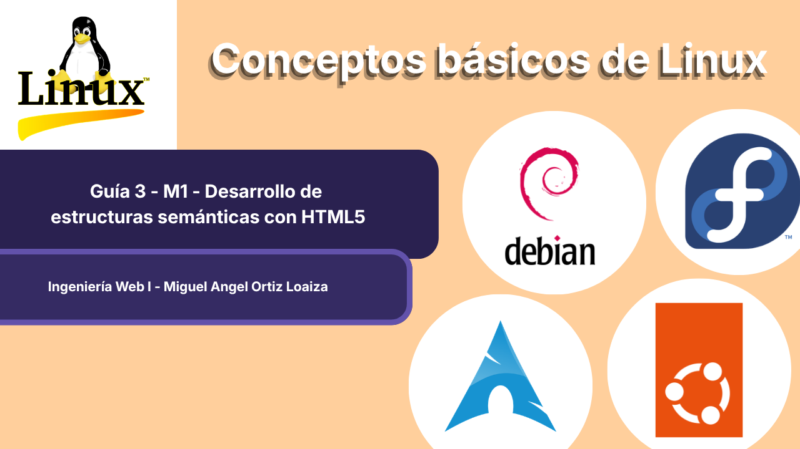

# Guía 3 - M1 - Desarrollo de estructuras semánticas con HTML5

    

## Propósito de la actividad

El estudioso deberá diseñar y desarrollar una página web utilizando las estructuras semánticas
de HTML5, aplicando correctamente las etiquetas que permiten organizar el contenido de una
página de acuerdo con su función. 

## Resultado de aprendizaje
Reconoce los fundamentos de la Ingeniería Web, la arquitectura básica de una aplicación web y
los elementos necesarios para construir páginas web estructuradas utilizando HTML5.

## ¿Cómo ejecutar el proyecto?
Para ejecutar el proyecto en local, es necesario clonar este repositorio y abrir el archivo index.html en el navegador. Alternativamente, se ingresar al sitio de [GitHub Pages](https://ctrl-angelus.github.io/Ingenieria-Web-1_Guia-3/)

## Herramientas que se utilizaron
El editor de código que utilicé para esta actividad fue Neovim (Lazyvim). Para navegadores web se usó Zen (Firefox) y Brave (Chromium) y sus respectivas herramientas de desarrollador. Para Servidor local se usó http.server de python y Ngrok.

## Video
Enlace al video del proyecto: [Video](https://youtu.be/jZ5f5KRk6cY?si=zXAiyftrMpqI3Q2Q)

